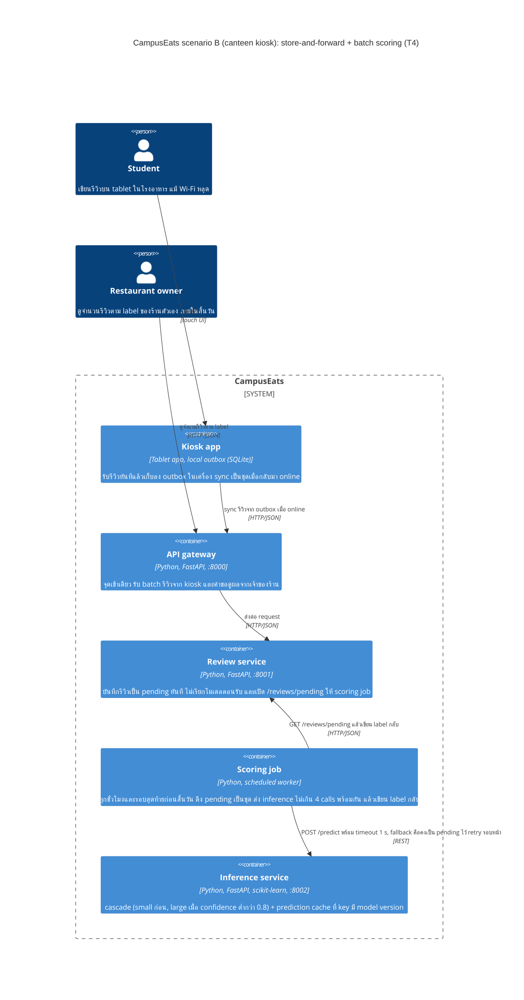

# Task 4: Deployment topologies and trade-offs

**Name / ชื่อ:** Watayut Aiamanan

**Student ID / รหัสนิสิต:** 6970267821

This is **individual work**: each student completes and submits their own copy, in their own fork.

*งานนี้เป็น**งานเดี่ยว** นิสิตแต่ละคนทำและส่งงานของตัวเอง ใน fork ของตัวเอง*

**Scenario (A, B or C) / Scenario ที่เลือก:** B (Canteen kiosk)

Choose **one** scenario below. If the last digit of your student ID is odd, take A or B; if it is even, take B or C. Use your measurements from Tutorial 6 as evidence: cite run names from `results/runs.csv`. Answer in Thai or English.

เลือก scenario **หนึ่ง** ข้อด้านล่าง ถ้าเลขตัวสุดท้ายของรหัสนิสิตเป็นเลขคี่ ให้เลือก A หรือ B ถ้าเป็นเลขคู่ ให้เลือก B หรือ C ใช้ผลการวัดจาก tutorial ที่ทำไปเป็นข้อมูลอ้างอิง โดยอ้างชื่อ run จาก `results/runs.csv` จะตอบเป็นภาษาไทยหรือภาษาอังกฤษก็ได้

Facts that hold in every scenario / ข้อเท็จจริงที่ใช้กับทุก scenario:

- The large model serves at most **20 calls per second** (4 calls at once × about 200 ms each), and every call costs money.

  *large model รับได้สูงสุด **20 calls ต่อวินาที** (พร้อมกัน 4 calls × ประมาณ 200 ms ต่อ call) และทุก call มีค่าใช้จ่าย*
- The small model is fast and cheap enough to run anywhere, including inside the review service or on a kiosk, but it is much less accurate on its own.

  *small model เร็วและถูกพอที่จะรันที่ไหนก็ได้ รวมถึงภายใน review service หรือบน kiosk แต่ถ้าใช้ตัวเดียวจะแม่นน้อยกว่ามาก*

## Scenarios

**A. Owner alerts.** When a customer posts a negative review, the restaurant owner gets a push notification within **2 seconds**. At the lunch peak, CampusEats receives **40 reviews per second**. A missed alert is acceptable, but a wrong alert (for example, "your customer is unhappy" when they are happy) makes owners stop trusting alerts and, in the end, ignore them.

*เมื่อลูกค้าโพสต์รีวิวเชิงลบ เจ้าของร้านจะต้องได้รับ push notification ภายใน **2 วินาที** เวลาช่วงพีคตอนเที่ยง CampusEats ได้รับรีวิวจำนวน **40 รายการต่อวินาที** การพลาด alert ไปบ้างนั้นยอมรับได้ แต่ alert ที่ผิด (เช่น "ลูกค้าไม่พอใจ" ทั้งที่จริงๆ แล้วพอใจ) จะทำให้เจ้าของร้านไม่เชื่อถือและเลิกสนใจ alert ในที่สุด*

**B. Canteen kiosk.** A tablet in each canteen lets students leave a review on the spot. However, the canteen Wi-Fi is poor: the tablets lose their connection several times a day, for minutes at a time. The system must accept every review, even while a tablet is offline. Restaurant owners need the labels **by the end of the day**.

*มี tablet ในแต่ละโรงอาหารให้นิสิตรีวิวได้ทันที อย่างไรก็ดี การเชื่อมต่อ Wi-Fi ในโรงอาหารไม่ดี ทำให้ tablet หลุดการเชื่อมต่อวันละหลายครั้ง ครั้งละหลายนาที ระบบจะต้องรับรีวิวได้ทุกรายการแม้ขณะที่กำลัง offline อยู่ และเจ้าของร้านต้องการ label **ภายในสิ้นวัน***

**C. Weekly report.** Restaurant owners want a weekly sentiment report. Nothing in producing this report has to be real-time. **Accuracy matters most** and **cost must be minimal**.

*เจ้าของร้านต้องการรายงาน sentiment รายสัปดาห์ ไม่มีอะไรที่จะต้องทำแบบ real-time ในการออกรายงานนี้ ความแม่นยำ **(accuracy) สำคัญที่สุด** และ **ค่าใช้จ่ายต้องน้อยที่สุด***

## Topologies and patterns to choose from / Topology และ pattern ที่เลือกใช้ได้

| | Topology | Where the model runs / โมเดลรันที่ไหน |
|---|---|---|
| T1 | Model as a service, synchronous | Inference service, called for each review (today's baseline) *inference service ถูกเรียกทุกรีวิว (baseline ของวันนี้)* |
| T2 | Model as a library | Inside the review service, or on the device *ภายใน review service หรือบนอุปกรณ์* |
| T3 | Hybrid | Small model locally, large model as a remote service *small model รันในเครื่อง large model เป็น remote service* |
| T4 | Asynchronous / batch | Reviews are queued (broker, W10) or stored, and scored later in bulk *รีวิวถูกเข้าคิว (broker, W10) หรือเก็บไว้ แล้วติด label ทีหลังเป็นชุด* |

Combine one topology with any of the patterns from Tutorial 6: **fallback**, **cascade** and **cache**.

*เลือก topology หนึ่งแบบ แล้วผสมกับ pattern จาก Tutorial 6 ได้ตามต้องการ: **fallback**, **cascade** และ **cache***

## 1. Quality requirements

The three most important quality requirements for your scenario, each with a number where possible.

*quality requirements ที่สำคัญที่สุด 3 ข้อของ scenario ที่เลือก ระบุตัวเลขเมื่อทำได้*

| # | Quality | Requirement |
|---|---|---|
| 1 | Availability / Reliability | รับรีวิวได้ 100% แม้ tablet offline วันละหลายครั้ง ครั้งละหลายนาที รีวิวต้องไม่หายแม้แต่รายการเดียว (0 lost reviews) และการรับรีวิวต้องไม่ขึ้นกับ network หรือ inference service ในขณะนั้น |
| 2 | Timeliness (freshness ของ label) | ทุกรีวิวที่ sync ถึงระบบภายในวัน ต้องมี label ก่อนสิ้นวัน (batch รอบสุดท้ายเริ่มไม่เกิน 23:00 และต้องเสร็จก่อน 24:00) ไม่ต้องการ real-time |
| 3 | Accuracy และ Cost | label ถูกต้องอย่างน้อย 90% ของรีวิวที่ได้ label (QR3) โดยส่ง large model ให้น้อยที่สุดและไม่เกิน 20 calls/s (QR4, QR5) เป้าหมายจากที่วัดได้: accuracy 93.5% ที่ large calls 40% (t3-cache-0.8) |

## 2. Design / การออกแบบ

Your topology, the patterns you add, and a container-level diagram (C4 level 2). The C4 diagram must be written in Mermaid.

*topology ที่เลือก pattern ที่เพิ่ม และ diagram ระดับ container (C4 level 2) เขียนด้วย Mermaid*

**Topology ที่เลือก: T4 Asynchronous / batch** ผสมกับ pattern ทั้งสามจาก Tutorial 6

- **รับรีวิว (store-and-forward):** Kiosk app บน tablet รับรีวิวแล้วเขียนลง outbox ในเครื่องทันที จึงรับได้แม้ offline เมื่อ Wi-Fi กลับมาจึง sync เป็นชุดไปที่ gateway → review service ซึ่งบันทึกรีวิวเป็น `pending` โดยไม่เรียกโมเดลตอนรับ การรับรีวิวจึงไม่ขึ้นกับ network และ inference service เลย
- **ติด label ทีหลัง (batch):** Scoring job ทำงานเป็นรอบ (ทุกชั่วโมง และรอบสุดท้ายก่อนสิ้นวัน) ดึง `GET /reviews/pending` แล้วส่ง inference service ครั้งละไม่เกิน 4 calls พร้อมกัน (ไม่เกิน 20 calls/s ตามเพดานของ large model) และเขียน label กลับลง review store
- **cascade:** inference service ถาม small model ก่อน ส่งต่อ large เฉพาะเมื่อ confidence ต่ำกว่า 0.8 (ค่าที่เลือกจาก Task 2: accuracy 93.5% เท่า large ที่ 64% ของ calls)
- **cache:** prediction cache ที่ key มี model version รีวิวโรงอาหารสั้นและซ้ำกันมาก จึงลด large calls เหลือ 40% (t3-cache-0.8)
- **fallback:** call ที่ timeout (1 s) หรือ error ทำให้รีวิวคงสถานะ pending และถูก retry ในรอบถัดไป ไม่มีรีวิวหาย

## 3. Evidence / หลักฐาน

Which runs support your choice? Show the numbers and, for scenario A, the capacity arithmetic: how many large-model calls per second does your design need at the peak?

*run ไหนที่สนับสนุนการตัดสินใจของนิสิต ให้นิสิตแสดงตัวเลขประกอบ และสำหรับ scenario A ให้นิสิตแสดงการคำนวณ capacity ด้วย เพื่อแสดงว่าในช่วงพีคนั้น design ของนิสิตต้องใช้ large model กี่ calls ต่อวินาที*

| Run | What it shows / แสดงอะไร |
|---|---|
| t1-after (เทียบ t1-before) | fallback ทำให้ errors 18 → 0 และรีวิวที่ติด label ไม่ได้ถูกเก็บเป็น pending 27 รายการแทนที่จะหาย run time 26.2 → 9.3 s พิสูจน์ว่า "เก็บก่อน ติด label ทีหลัง" ปลอดภัย ซึ่งเป็นแกนของ T4 |
| t2-0.8 | cascade threshold 0.8 ได้ accuracy 93.5% เท่ากับ t0-large แต่ใช้ large calls 64% ผ่าน QR3 (90%) ด้วย margin 3.5 จุด |
| t3-cache-0.8 | เปิด cache: large calls เหลือ 40%, cache hits 34%, accuracy 93.5% คงเดิม รีวิวโรงอาหารสั้นและซ้ำ (เช่น "Delicious!", "Too salty") จึงได้ประโยชน์เต็มที่ |
| t0-small | small model ตัวเดียวได้ accuracy 72.5% ต่ำกว่า QR3 (90%) มาก จึงตัด T2 (รันโมเดลบน kiosk อย่างเดียว) ออก |
| t0-large | sync ทุกรีวิวไป large: cost 100%, p50 505 ms จ่ายแพงเพื่อ latency ที่ scenario B ไม่ต้องการ (label ภายในสิ้นวันก็พอ) |

Capacity (ไม่บังคับสำหรับ scenario B แต่ยืนยันว่า batch ทันสิ้นวัน): สมมติ 5,000 รีวิว/วัน × 40% = 2,000 large calls ÷ 20 calls/s ≈ 100 วินาที ต่อให้ 20,000 รีวิว/วันก็ใช้เวลาราว 7 นาที จึงทันสิ้นวันสบายและไม่ชนเพดาน QR5 แม้รวมรีวิวที่ค้างจากช่วง offline ทั้งวันมาส่งพร้อมกัน

## 4. ADR

Use the ADR format from W5.

*ใช้รูปแบบ ADR จาก W5*

**Title:** ใช้ topology แบบ asynchronous/batch (T4): kiosk เก็บรีวิวลง outbox แล้วติด label ย้อนหลังด้วย cascade + cache + fallback

**Status:** Proposed

**Context:** Scenario B: tablet ในโรงอาหารหลุด Wi-Fi วันละหลายครั้ง ครั้งละหลายนาที ระบบต้องรับรีวิวได้ทุกรายการแม้ offline และเจ้าของร้านต้องการ label ภายในสิ้นวันเท่านั้น (ไม่ต้อง real-time) large model แพงและรับได้ไม่เกิน 20 calls/s ส่วน small model ถูกแต่แม่นแค่ 72.5% (t0-small) จาก Tutorial 6 วัดได้ว่า fallback ทำให้รีวิวที่ติด label ไม่ได้ถูกเก็บเป็น pending โดยไม่มี error (t1-after: 0 errors, 27 pending) และ cascade 0.8 + cache ให้ accuracy 93.5% เท่า large โดยใช้ large calls เพียง 40% (t3-cache-0.8) จุดสำคัญคือ scenario นี้ไม่มีใครต้องการ label ภายในวินาทีที่โพสต์ จึงไม่จำเป็นต้องผูกการรับรีวิวไว้กับการเรียกโมเดล

**Decision:** เลือก T4 Asynchronous / batch: (1) kiosk app เก็บรีวิวลง outbox ในเครื่องและ sync เมื่อ online (2) review service บันทึกรีวิวเป็น pending ทันทีโดยไม่เรียกโมเดลตอนรับ (3) scoring job รันทุกชั่วโมงและรอบสุดท้ายก่อนสิ้นวัน ดึง /reviews/pending ส่ง inference service ครั้งละไม่เกิน 4 calls พร้อมกัน (4) inference service ใช้ cascade threshold 0.8 และ prediction cache ที่ key มี model version (5) fallback: call ที่ timeout 1 s หรือ error คงเป็น pending และ retry รอบถัดไป

**Consequences:**
- Positive:
  - ไม่มีรีวิวหายแม้ offline เพราะการรับรีวิวไม่พึ่ง network และ inference service (หลักการเดียวกับ t1-after: 0 errors)
  - cost ลดเหลือราว 40% ของ baseline โดย accuracy 93.5% เท่า large (t3-cache-0.8) และ batch ควบคุมอัตราได้เองไม่เกิน 20 calls/s จึงไม่ชนเพดาน QR5 และไม่ต้องขยาย capacity สำหรับช่วงพีค
  - inference service ช้าหรือล่มระหว่างวันไม่กระทบผู้ใช้ แค่เลื่อน label ไปรอบถัดไป และ retry อัตโนมัติ
- Negative:
  - label ไม่ real-time: เจ้าของร้านเห็นลูกค้าไม่พอใจช้าสุดถึงสิ้นวัน ใช้กับ scenario แบบ owner alerts (A) ไม่ได้
  - ชิ้นส่วนเพิ่มขึ้น: outbox บน tablet, scheduler/worker, การกัน duplicate เมื่อ kiosk ส่งซ้ำหลัง sync ล้มเหลว (ต้องมี review id จากฝั่ง kiosk และ POST แบบ idempotent) และ monitoring ว่า batch รอบสุดท้ายเสร็จก่อนสิ้นวัน
  - ถ้า inference service ล่มทั้งวัน pending จะกองและพลาด deadline สิ้นวัน ต้องมี alert และ cache ต้องผูกกับ model version ไม่เช่นนั้นจะได้ label เก่าหลังเปลี่ยนโมเดล

**Alternatives considered:** at least one topology you rejected, and why.

*อย่างน้อยหนึ่ง topology ที่ไม่เลือก และเหตุผล*

> **T1 Model as a service, synchronous (ไม่เลือก):** การรับรีวิวต้องมี network และ inference service พร้อมในขณะนั้น ขัดกับ requirement ที่ tablet offline วันละหลายครั้ง และจ่าย large call ทันทีในช่วงพีคทั้งที่ไม่มีใครต้องการ label ภายในวินาทีนั้น (t0-large: cost 100%, p95 585 ms ที่ซื้อมาโดยไม่ได้ใช้) ต่อให้เพิ่ม fallback แบบ Task 1 ก็ยังต้องมี outbox บน kiosk อยู่ดี
>
> **T2 Model as a library บน kiosk (ไม่เลือก):** small model รันบน tablet ได้และติด label ได้ทันทีแม้ offline แต่ accuracy 72.5% (t0-small) ต่ำกว่า QR3 ที่ 90% มาก ส่วน large model หนักเกินกว่าจะรันบน tablet และ update โมเดลบนอุปกรณ์หลายสิบเครื่องยุ่งยาก
>
> **T3 Hybrid (ไม่เลือก):** small บน kiosk ให้ label ชั่วคราวแล้วค่อยยืนยันด้วย large ที่ server ให้ข้อดีเรื่องเห็นผลทันที ซึ่ง scenario B ไม่ต้องการ แลกกับภาระ deploy/update โมเดลบน tablet ทุกเครื่อง และสุดท้ายก็ยังต้องมีทั้ง outbox และ batch scoring เหมือน T4 อยู่ดี
